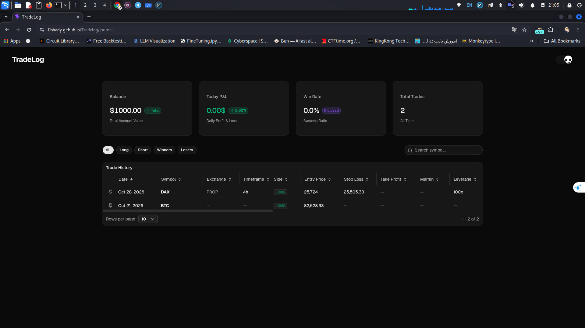
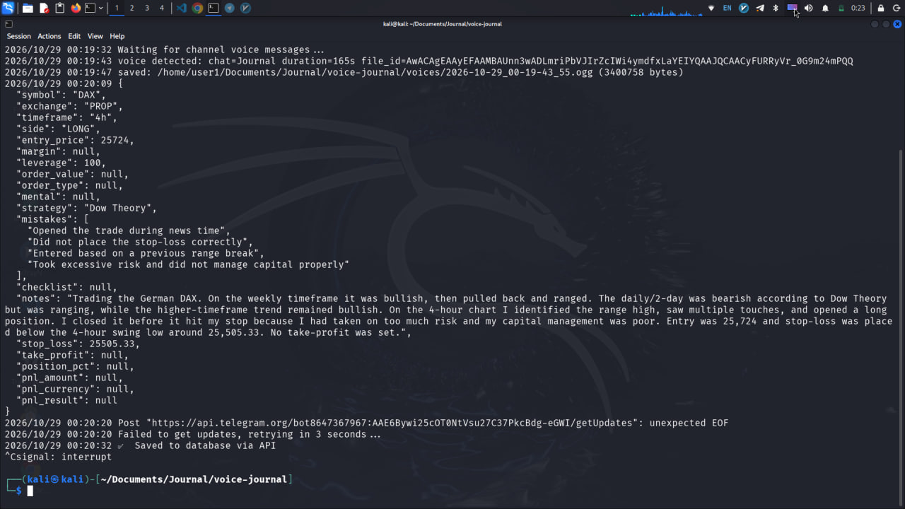

# TradeLog

<div align="center">
  
  <h1>TradeLog — Smart Trading Journal</h1>
  <p>A personal trading journal to record trades, review performance, and build better trading habits.</p>

  <p>
    <a href="https://i1shady.github.io/Tradelog/">
      
    </a>
  </p>

  <p>
    
    
    
    
    
    
    
    
  </p>
</div>

---

## Overview

**TradeLog** is a personal trading journal that helps turn individual trades into useful, reviewable records.

Log your positions, document the reasoning behind your decisions, keep track of your trading checklist, and review your results in one place. TradeLog also includes **Voice Journal**, which turns spoken trade notes into an editable trade draft with the help of speech recognition and an AI model.

The application is built to run with a local frontend, backend, and SQLite database. OpenRouter is used for the AI-powered voice-processing steps.

## Features

- **Trading Journal** — Create, browse, and update trade records.
- **Performance Dashboard** — Review account balance, realized P&L, today's P&L, win rate, and total trades.
- **Trade History** — Search by symbol or exchange and filter by direction or result.
- **Trade Details** — Keep information such as entry, margin, leverage, stop loss, take profit, strategy, mindset, notes, and screenshots together.
- **Customizable Checklist** — Record whether key trading conditions were met.
- **Voice Journal** — Record a voice note in the browser and convert it into a text transcript.
- **AI Trade Extraction** — Send the transcript with the TradeLog extraction prompt to an AI model and receive structured trade data.
- **Review Before Saving** — Inspect and edit the generated trade fields before saving the record.
- **Light and Dark Themes** — Switch between the available interface themes.

## Screenshots

<p align="center">
  
</p>

<p align="center">
  
</p>

## Voice Journal Workflow

Voice Journal is part of the React application. It does not require the previous Go bot, remote Whisper.cpp runtime, ngrok tunnel, or MoLab notebook.

The current workflow is:

```text
Browser Microphone
       |
       v
   Audio Recording
       |
       v
 React Voice Journal
       |
       v
 POST /api/transcribe
       |
       v
 OpenRouter Whisper
       |
       v
 Persian Transcript
       |
       v
 User Reviews Transcript
       |
       v
 POST /api/process-voice
       |
       v
 AI Trade Extraction
       |
       v
 Editable Trade Draft
       |
       v
 User Reviews / Edits
       |
       v
 POST /api/trades
       |
       v
    SQLite Database
```

The AI-generated result is **not saved automatically**. You can review and edit the extracted fields first, then explicitly save the trade.

### Voice Journal API endpoints

| Method | Endpoint | Purpose |
|---|---|---|
| `POST` | `/api/transcribe` | Sends recorded audio to OpenRouter for transcription |
| `POST` | `/api/process-voice` | Sends the transcript and extraction prompt to the configured AI model |
| `GET` | `/api/trades` | Retrieves all trade records |
| `GET` | `/api/trades/:id` | Retrieves one trade |
| `POST` | `/api/trades` | Saves a new trade |
| `PUT` | `/api/trades/:id` | Updates an existing trade |

## Tech Stack

| Area | Technology |
|---|---|
| Frontend | React, TypeScript, Vite |
| Styling | Tailwind CSS |
| UI Components | Base UI, shadcn-style components, Lucide |
| Routing | React Router |
| Backend | Node.js, Express |
| Database | SQLite with better-sqlite3 |
| Speech-to-Text | OpenRouter audio transcription API (Whisper) |
| AI Trade Extraction | OpenRouter Chat Completions API |
| AI Model | DeepSeek V4.1 Flash (configured in the backend) |

## Getting Started

### Requirements

- Node.js and npm
- An [OpenRouter API key](https://openrouter.ai/keys) for Voice Journal

### 1. Clone the repository

```bash
git clone https://github.com/I1Shady/Tradelog.git
cd Tradelog
```

### 2. Configure the backend

Create a `.env` file inside the `backend` directory:

```env
OPENROUTER_API_KEY=your_openrouter_api_key
PORT=5000
```

Install dependencies and start the API:

```bash
cd backend
npm install
node server.js
```

The backend starts on port `5000` by default. The SQLite database file (`tradelog.db`) is created automatically in the backend directory when the database is initialized.

### 3. Configure the frontend

Create a `.env.local` file inside the `front` directory:

```env
VITE_API_URL=http://localhost:5000
```

Install dependencies and start the Vite development server:

```bash
cd front
npm install
npm run dev
```

Open the local URL printed by Vite in your browser.

### 4. Use TradeLog

- Open the journal to browse and manage trade records.
- Open **Voice Journal** to record a note.
- Transcribe the recording, review the transcript, and continue to AI extraction.
- Review and edit the generated trade draft.
- Select **Save** when the information is ready to be stored.

Microphone access requires a secure browser context, such as **localhost** or HTTPS.

## Configuration Notes

- Keep `OPENROUTER_API_KEY` in the backend environment. Do not expose it in frontend code or commit it to Git.
- `VITE_API_URL` is the base URL of the backend API. Set it to your deployed backend URL when the frontend and backend run on different hosts.
- The transcription and trade-extraction requests are sent from the backend to OpenRouter.
- Voice recordings and transcripts are sent to the external AI provider when you use Voice Journal. Avoid submitting sensitive information you do not want processed by that provider.
- Trade records are stored in the backend's SQLite database. If you deploy the backend, make sure its database file is persisted and backed up.

## Project Structure

```text
Tradelog/
├── backend/
│   ├── db.js
│   ├── server.js
│   └── package.json
├── front/
│   ├── public/
│   ├── src/
│   │   ├── components/
│   │   ├── context/
│   │   ├── css/
│   │   ├── lib/
│   │   ├── pages/
│   │   └── types/
│   ├── package.json
│   └── vite.config.ts
└── README.md
```

## Roadmap

Ideas being explored for future versions:

- AI-assisted chart and screenshot analysis.
- More flexible trade analytics and reporting.
- Further improvements to trade review and editing.
- Desktop and mobile experiences.

## Support

If you find TradeLog useful and would like to support its development, you can contribute through one of the wallets below.

- **USDT (BEP20):** `0xF6DA36c843bbb218422fee6f8798e2874c2baAC1`
- **TRX (TRC20):** `TVxnAFuTmbXANaMvAadLipM6j78UPWT8QS`

---

<div align="center">
  <p>Built to make every trade a learning opportunity.</p>
</div>
