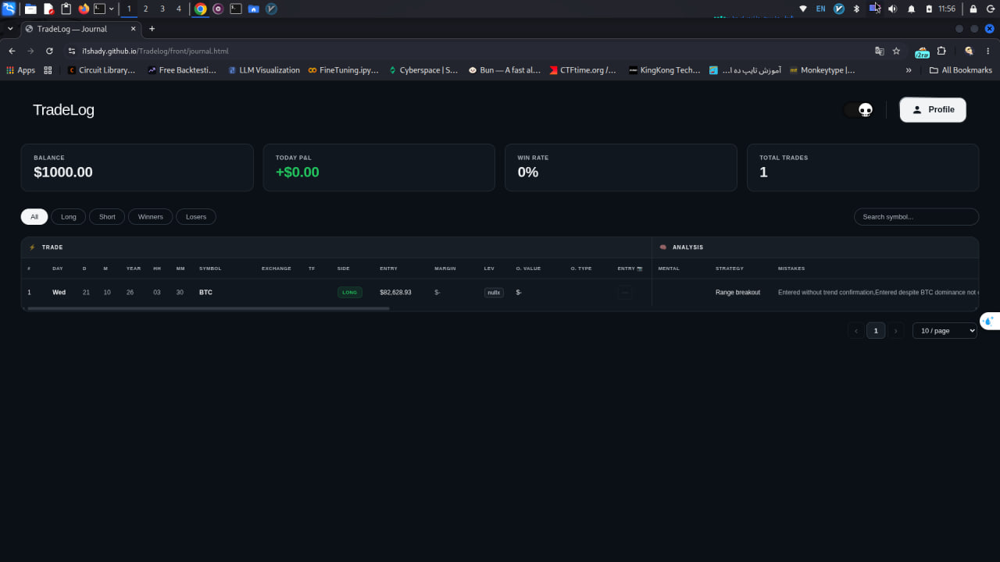
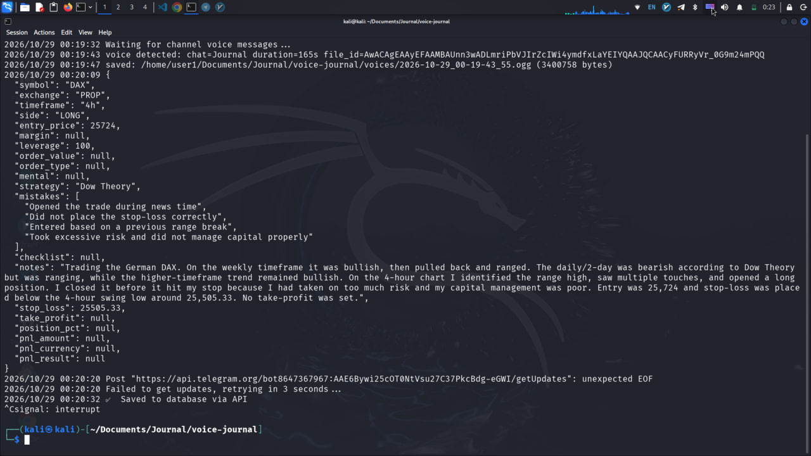

# TradeLog

<div align="center">
  
  <h1>TradeLog - Smart Trading Journal</h1>
  <p>Your ultimate companion for tracking, analyzing, and improving your trades.</p>
</div>

---

## Overview

**TradeLog** is a trading journal designed to turn trading activity into structured, reviewable data.

Instead of relying on memory or scattered notes, traders can record their setups, document their reasoning, review their performance, and identify patterns in their decisions.

TradeLog also includes **Voice Journal**, a companion service that converts Persian voice notes into structured trading journal entries using speech recognition and AI-powered data extraction.

## Features

- **Trading Journal:** Record and review trading activity in one place.
- **Voice Journal:** Turn Persian voice notes into structured journal entries.
- **AI-Powered Extraction:** Extract relevant trading information from transcribed voice notes and organize it into structured data.
- **Performance Analytics:** Review trading statistics and evaluate performance over time.
- **Customizable Checklist:** Keep track of trading conditions before entering a trade.
- **Market Visualization:** Review trading information alongside market charts.
- **PostgreSQL Storage:** Store journal entries and related data in a database.

## Screenshots

<p align="center">
  
</p>

<p align="center">
  
</p>

## Tech Stack

| Component | Technology |
|---|---|
| Frontend | HTML, CSS, JavaScript |
| Backend | Node.js, Express |
| Database | PostgreSQL |
| Speech Recognition | Whisper.cpp |
| Speech Recognition API | Python, FastAPI |
| Public API Access | ngrok |
| AI Data Extraction | DeepSeek API |
| Voice Journal | Go |
| Runtime Environment | MoLab |

## Architecture

TradeLog consists of a web application and a separate Voice Journal service.

The voice-processing pipeline works as follows:

```text
Telegram Voice Message
        |
        v
   Go Telegram Bot
        |
        v
   Remote Whisper API
   (FastAPI + Whisper.cpp)
        |
        v
   Persian Transcription
        |
        v
   DeepSeek API
        |
        v
 Structured Trading Data
        |
        v
   PostgreSQL / TradeLog
```

Whisper.cpp runs in a remote MoLab runtime rather than on the user's local machine. FastAPI exposes the transcription endpoint, while ngrok provides a public URL that the Go service can reach.

This separation keeps the speech-recognition workload independent of the local machine and allows the transcription service to be managed separately from the main application.

## Voice Journal: Remote Whisper Setup

Voice Journal uses a custom Persian Whisper model, `ggml-persian-v4.bin`, with Whisper.cpp.

The transcription service runs in MoLab and exposes two HTTP endpoints:

| Endpoint | Purpose |
|---|---|
| `GET /health` | Check whether the API is responding |
| `POST /transcribe` | Upload an audio file and receive its transcription |

The transcription endpoint accepts an audio file and an `X-API-Key` header. On success, it returns the transcript as JSON.

Example response:

```json
{
  "text": "Your transcribed Persian voice note"
}
```

### 1. Prepare the MoLab environment

Open the MoLab notebook provided in `Voice-Journal/molab.py`.

The runtime needs:

- Python and the required notebook dependencies.
- A working Whisper.cpp build.
- The Persian Whisper model `ggml-persian-v4.bin`.
- FastAPI and Uvicorn for the HTTP service.
- ngrok for exposing the API to the internet.

The notebook uses Google Drive access to retrieve the model and project files. Make sure the required files are accessible in your Drive before starting the service.

### 2. Start the transcription API

Run the notebook cells needed to initialize Whisper.cpp, load the model, and start FastAPI.

Once the API is running, ngrok exposes the local service through a public URL.

The resulting URL is used as the `WhisperAPIURL` value in the Go service configuration.

**Important:** The MoLab runtime must remain active while Voice Journal needs transcription. If the runtime stops or restarts, the API and its ngrok URL may become unavailable or change. Start the service again and update the configuration when necessary.

### 3. Configure Voice Journal

Open the Go configuration file in `Voice-Journal` and set the required values:

```go
package config

const (
    TelegramBotToken = "YOUR_TELEGRAM_BOT_TOKEN"

    AIAPIKey  = "YOUR_AI_API_KEY"
    AIBaseURL = "https://seekai.cc/v1"
    AIModel   = "deepseek-ai/DeepSeek-V4-Flash-0731"

    BaseDir   = "/path/to/voice-journal/"
    VoicesDir = BaseDir + "voices"

    WhisperAPIURL = "YOUR_NGROK_API_URL"
    WhisperAPIKey = "YOUR_WHISPER_API_KEY"
)
```

Replace the example values with your own configuration. The `WhisperAPIURL` should point to the running remote API, not to a local Whisper.cpp executable.

Keep API keys and bot tokens private. Do not commit real credentials to GitHub.

### 4. Run the Go service

From the `Voice-Journal` directory, install the Go dependencies and run the application:

```bash
go mod download
go run ./cmd/app
```

The bot can then receive voice messages, send audio to the remote transcription API, pass the transcript to the configured AI model, and process the extracted trading information.

The exact behavior depends on the current Go implementation and its configuration.

## Web Application Setup

### Frontend

The frontend is built with HTML, CSS, and JavaScript.

If you deploy it using GitHub Pages or another static hosting provider, make sure the frontend is configured to use the correct backend API URL.

### Backend and Database

The backend uses Node.js and Express, with PostgreSQL for persistent storage.

Configure the backend's database connection and required environment variables before starting the application. Keep database credentials out of source control.

The frontend, backend, and Voice Journal service are separate components, so each must be configured to communicate with the correct endpoint.

## Roadmap

- 🤖 **Image Analyzer**: AI-powered chart screenshot analysis.
- 📱 **Voice-to-JSON Review UI**: A sleek, swipe-friendly interface to review and approve AI-extracted trade data before saving to the database (Human-in-the-loop confirmation).
- 🚀 **Cross-Platform Apps**: Port the entire app to native desktop (Windows, macOS, Linux) and mobile (Android, iOS) using frameworks like Tauri or Flutter.
- ⚡ **Performance & Speed**: Optimize database queries, add caching, and make the UI buttery smooth.
- 🛠 **Advanced Trade Updates & Support**: More powerful trade editing features, plus full-time hours dedicated to fixing bugs and responding to community requests.


## Support the Project

If you find TradeLog useful and want to support its development, you can contribute through the following wallets:

-  **USDT (BEP20):** `0xF6DA36c843bbb218422fee6f8798e2874c2baAC1`
-  **TRX (TRC20):** `TVxnAFuTmbXANaMvAadLipM6j78UPWT8QS`

## Disclaimer

TradeLog is a journaling and analysis tool, not financial advice. It does not guarantee profitable trading outcomes.

## License

See the repository for licensing information.
