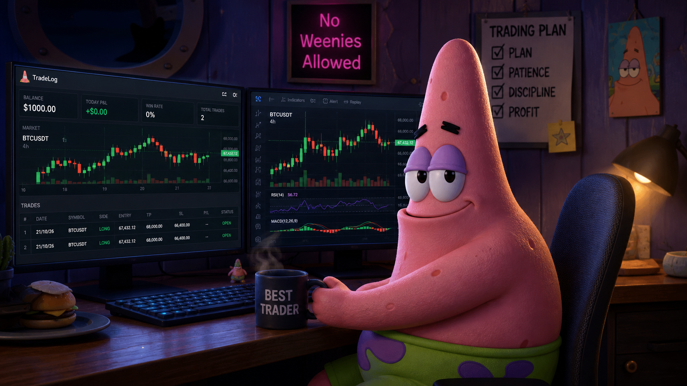
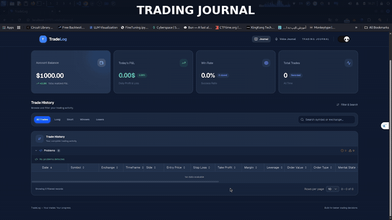

# TradeLog

<div align="center">
  
  <h1>TradeLog — Your Trading Thoughts, Captured.</h1>
  <p>A smarter way to journal your trades. Speak naturally, capture what is on your mind, and let AI turn your thoughts into structured trading records.</p>

  <p>
    <a href="https://i1shady.github.io/Tradelog/">
      
    </a>
  </p>

  <p>
    
    
    
    
    
    
    
  </p>
</div>

---

## The idea behind TradeLog

Trading moves fast. When you're watching a chart, managing a position, or thinking through a setup, the last thing you want is to stop and fill out a long journal form.

But those moments are exactly when your thoughts matter most.

**TradeLog is built to capture them.**

Instead of interrupting your trading to manually enter every detail, simply open Voice Journal and talk. Explain what you're seeing, why you're entering a trade, what you're feeling, what you're worried about, or anything else going through your mind.

You don't need to organize your thoughts or speak in a specific format. Just talk naturally. TradeLog uses speech recognition and AI to turn that raw voice note into structured trade information that you can review, edit, and save.

The goal is simple: **spend less time filling out your journal and more time thinking about your decisions.**

## Voice Journal — Your thoughts, turned into a journal

<blockquote>
  "You shouldn't have to remember every detail of a trade or interrupt your thought process just to write it down. Say it while it's happening. Keep the context. Review it later."
</blockquote>

Voice Journal is the heart of TradeLog.

- **Speak freely** — Record your thoughts naturally while analyzing a chart or managing a position. No rigid template or special phrases required.
- **Capture the context** — Describe your setup, reasoning, emotions, doubts, mistakes, market conditions, or anything you want to remember.
- **Automatic transcription** — Your recording is converted into text using speech recognition, with support for Persian voice notes.
- **AI-powered structuring** — The AI interprets your transcript and extracts the relevant trading details into a structured trade draft.
- **Review before saving** — Check the extracted information, correct anything you want, and save only when you're happy with the result.

Your voice note is the starting point—not a form you have to fill out. The original meaning of what you said matters, and the generated fields remain editable before they become a journal entry.

## More than voice notes

TradeLog brings your trade records and performance review together:

- **Trading Journal** — Keep your trades organized in one place.
- **Performance Dashboard** — Review balance, P&L, win rate, and trading activity.
- **Trade History** — Search records and filter by direction or result.
- **Detailed Trade Records** — Keep entry information, margin, leverage, stop loss, take profit, strategy, mindset, mistakes, notes, and screenshots together.
- **Trading Checklist** — Track whether your key conditions were met.
- **Light and Dark Themes** — Choose the interface that works best for you.

## Demo

See TradeLog in action. This short preview highlights the core Voice Journal workflow—from recording your thoughts to reviewing the AI-generated trade details.

<p align="center">
  
</p>

<p align="center">
  <a href="https://i1shady.github.io/Tradelog/">Try the Live Demo</a>
</p>

## How Voice Journal works

```text
  Your thoughts
       |
       v
  Record your voice
       |
       v
  Speech recognition
       |
       v
  Review the transcript
       |
       v
  AI understands the context
       |
       v
  Structured trade draft
       |
       v
  Review and edit
       |
       v
  Save to your journal
```

The AI does not silently add a trade to your journal. You stay in control: review the extracted information, make any corrections, and save it when it's ready.

## Customize the AI Prompt

TradeLog's voice-to-trade extraction instructions are kept in **`front/src/lib/prompts.ts`**. You can adapt this prompt to match the way you trade instead of being locked into a one-size-fits-all template.

For example, you can:

- Replace the default **Dow Theory** framework with your own trading strategy.
- Change the entry checklist to reflect the conditions you actually look for before opening a position.
- Add, remove, or rename checklist criteria to match your process—for example, trend direction, volume confirmation, higher-timeframe alignment, or BTC correlation.
- Adjust the extraction instructions so the AI understands the terminology and decision-making rules used in your own strategy.

The prompt defines the structure and rules the AI follows when turning your voice transcript into a trade draft. Keep its expected JSON fields and checklist keys aligned with the data structure used by the application when making changes.

This makes the journal adaptable to different trading styles and personal entry rules, rather than forcing every trader to follow the same checklist.

## Getting Started

### Requirements

- Node.js and npm
- An [OpenRouter API key](https://openrouter.ai/keys) for Voice Journal

### 1. Clone the repository

```bash
git clone https://github.com/I1Shady/Tradelog.git
cd Tradelog
```

### 2. Start the backend

Create a `.env` file inside the `backend` directory:

```env
OPENROUTER_API_KEY=your_openrouter_api_key
PORT=5000
```

Then install the dependencies and start the server:

```bash
cd backend
npm install
node server.js
```

### 3. Start the frontend

Create a `.env.local` file inside the `front` directory:

```env
VITE_API_URL=http://localhost:5000
```

Then install the dependencies and run the development server:

```bash
cd front
npm install
npm run dev
```

Open the local address shown by Vite in your browser.

### 4. Start journaling

Open **Voice Journal**, record a thought, and let TradeLog turn it into a draft. Review the transcript and extracted trade details, make any edits you need, and save your entry.

Browser microphone access requires HTTPS or localhost.

## Privacy & API Key

- Keep your OpenRouter API key in the backend `.env` file. Never put it in frontend code or commit it to Git.
- Voice recordings and transcripts are sent to OpenRouter for transcription and AI processing when you use Voice Journal.
- Trade entries are stored in the backend's SQLite database. If you host the backend yourself, make sure its database file is persisted and backed up.

## Roadmap

- **AI Chart Analyzer** — Get AI-assisted insights from chart screenshots.
- **Richer Journal Insights** — Discover patterns across trade decisions, notes, and performance.
- **Desktop & Mobile Apps** — Make TradeLog available across more devices.
- **A Better Review Experience** — Keep improving the way traders revisit and learn from their decisions.

## Support This Project

TradeLog is an independent project. If you find it useful and want to support its development, you can contribute through the wallets below. Every contribution helps make more improvements possible.

-  **USDT (BEP20):** `0xF6DA36c843bbb218422fee6f8798e2874c2baAC1`
-  **TRX (TRC20):** `TVxnAFuTmbXANaMvAadLipM6j78UPWT8QS`

---

<div align="center">
  <p><strong>Capture the thought. Understand the trade. Learn from every decision.</strong></p>
</div>
